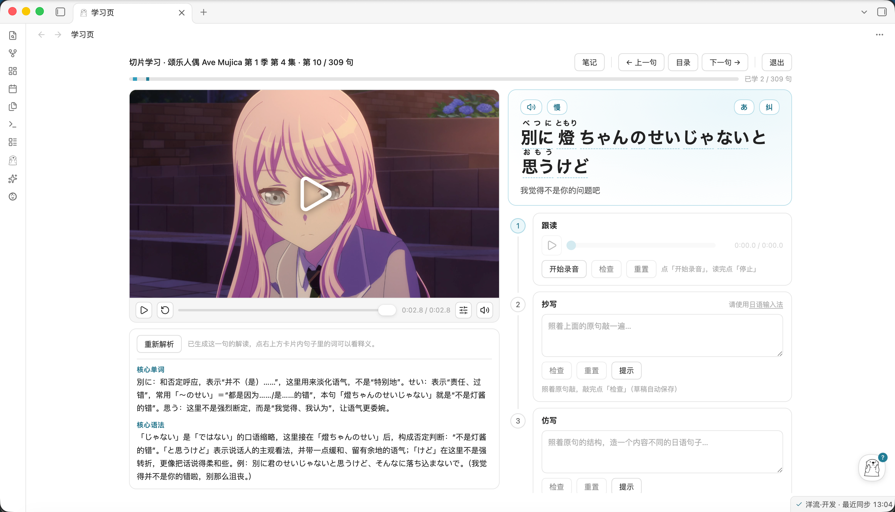
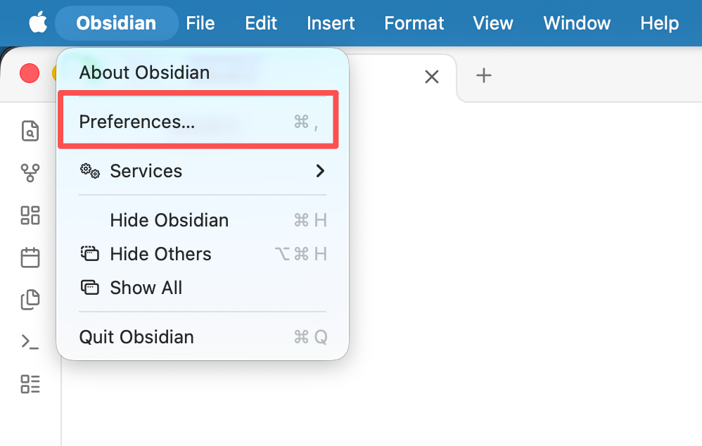
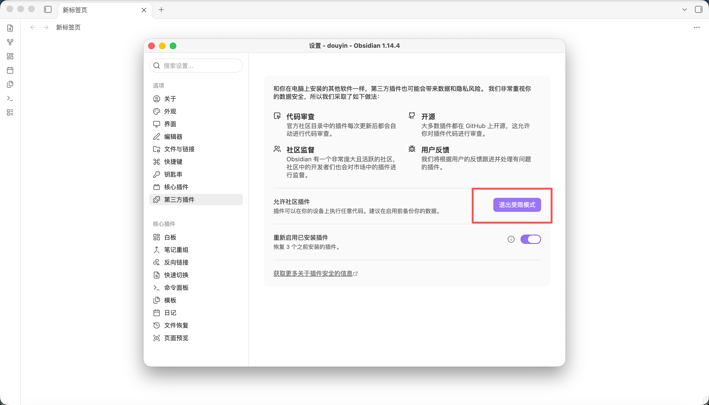
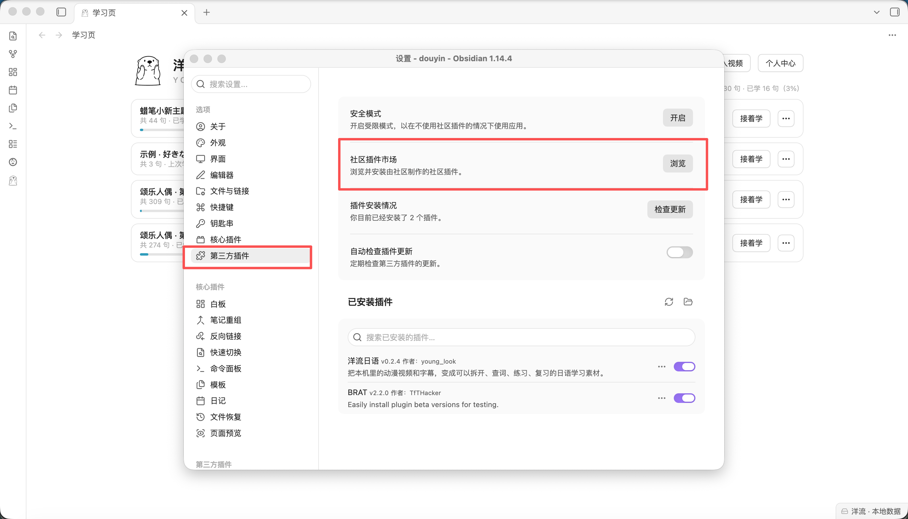
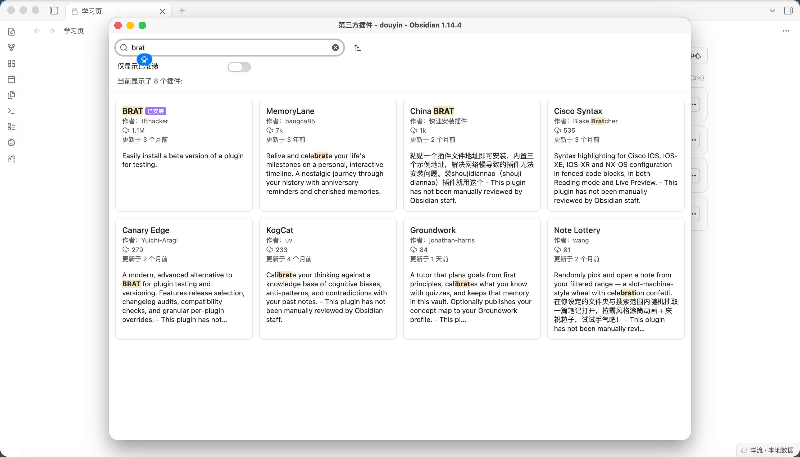
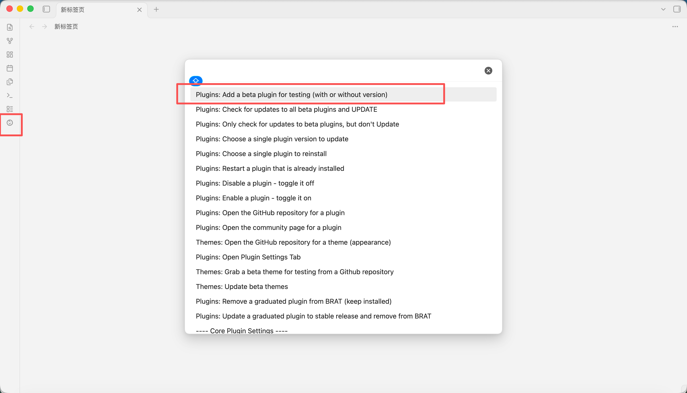
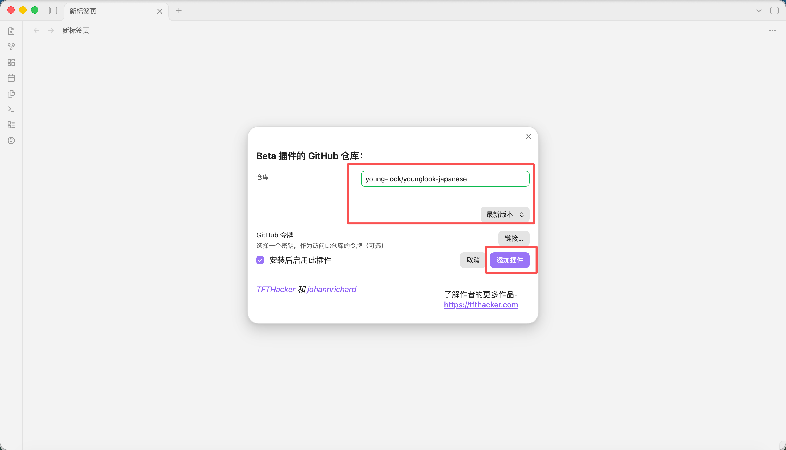
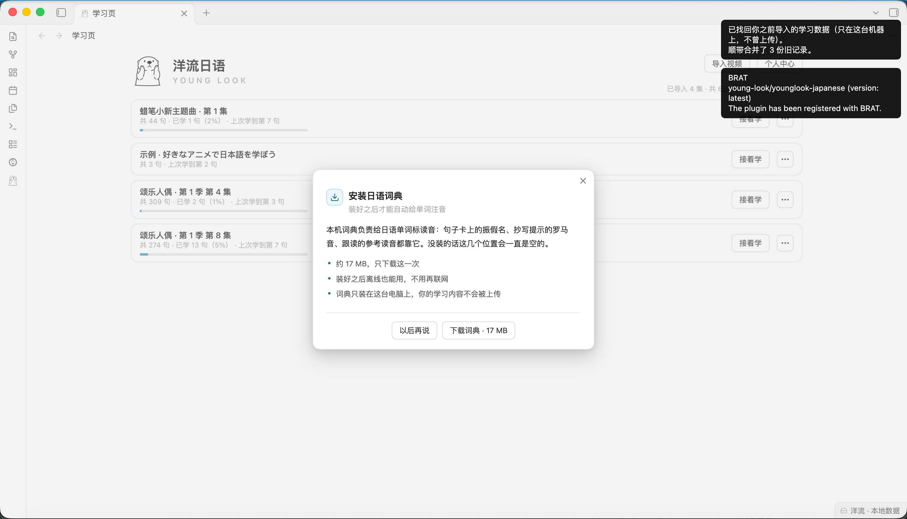
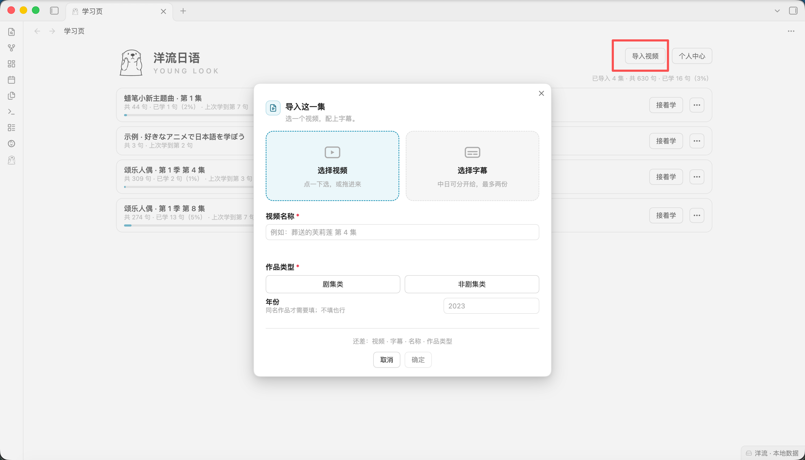

<div align="center">
  <h1>洋流日语 · YoungLook</h1>
  <picture>
    <source media="(prefers-color-scheme: dark)" srcset="docs/img/logo-dark.png">
    
  </picture>
</div>

> 把本机里的日语视频和字幕，变成可以拆开、查询、练习的日语学习素材。

Obsidian 插件 · Windows / macOS / Linux · Obsidian 1.5.0 以上



## 它能帮你做什么

看番剧学日语，最可惜的是台词一遍就过去了。洋流日语把你**已经在电脑里**的视频和字幕沉淀成你的学习素材：

- 停在任意一句，反复听、反复读
- 点词查义、查读音，生词自动收进生词本
- 跟读录音，回放对比原声
- 每一句都能随手写自己的笔记，登录后存在账号里，换设备也能看到

视频和字幕文件**原地不动**，插件只记路径 —— 不复制、不上传。

---

## 安装（约 2 分钟，两种方式选一种）

| 你的情况                               | 推荐方式 |
|----------------------|---|
| 电脑上已有 AI 工具（Codex / Claude Code / WorkBuddy 等） | **方式一：AI 安装** —— 发一段话，剩下的它全包 |
| 没有 AI 工具，但想以后自动更新                  | **方式二：BRAT 安装** —— Obsidian 官方的测试版插件工具 |
| 两者都不想                              | 方式三：完全手动（折叠在方式二末尾） |

### 方式一：AI 安装（适合电脑上有 AI 工具的用户）

整个安装没有一步需要点界面 —— 全是下载文件、放进插件目录、改一个配置列表，AI 工具能一口气做完。唯一的要求：你的 AI 工具得能操作这台电脑（能跑命令、能读写文件）；只在网页里聊天的 AI 干不了。

**第 1 步：把下面这段话原样复制，连同链接一起发给你的 AI 工具**

> 帮我安装这个 Obsidian 插件：https://github.com/young-look/younglook-japanese
>
> 如果本机还没装 Obsidian，先帮我装上。
> 
> 优先安装 BRAT 版，安装不了，就直接本地导入插件。
> 
> 全部完成后告诉我结果，Obsidian 我自己重启。

**第 2 步：重启 Obsidian**（完全退出再打开）。左侧栏出现**海獭图标**，点它就能开始 —— 第一课示例视频已经摆好了。

两个提醒：

- **「安全模式」需要你自己关一次**。刚装好、从没装过插件的 Obsidian 默认开着安全模式（受限模式），这个开关存在 Obsidian 内部，AI 关不掉。你自己关一次即可（设置 → 第三方插件 → 退出发布模式），以后一直有效。没关的话，AI 放好文件后左侧栏也不会出现图标。
- **AI 装的版本不会自动更新**。升级时把上面那段话再发一次就行；想彻底自动更新，用方式二（BRAT）。

### 方式二：BRAT 安装（自动更新，推荐没有 AI 工具的用户）

BRAT 是 Obsidian 官方的「测试版插件」工具，装好之后**自动更新**，不用每次手动下载。全程约 2 分钟，下面每一步都配了图，照着点就行。

#### 第 1 步：打开 Obsidian 设置

- **macOS**：点屏幕顶部菜单栏的 **Obsidian → Preferences…（偏好设置）**
- **Windows / Linux**：点左下角的**齿轮图标**



#### 第 2 步：关掉「安全模式」

设置窗口左侧选 **第三方插件**，点右上角的 **「退出发布模式」** 按钮（有的版本显示为「退出受限模式」，或是一个开关，关掉即可）。

> 这一步是必须的：新装的 Obsidian 默认开着安全模式，不关的话后面装不了任何社区插件。



#### 第 3 步：打开社区插件市场

在「第三方插件」页，点 **社区插件市场** 右边的 **「浏览」**。



#### 第 4 步：搜索并安装 BRAT

在市场里搜 **brat**，安装第一个 **BRAT**（作者 ttfhacker），然后**启用**它。



#### 第 5 步：打开 BRAT 的添加面板

BRAT 启用后，**左侧栏会出现 BRAT 的图标**，点它，选择第一条命令：

> **Plugins: Add a beta plugin for testing (with or without version)**

（中文界面显示为「Plugins: 添加一个用于测试的 beta 插件」之类的条目，认准 **Add a beta plugin** 就行）



#### 第 6 步：粘贴洋流日语的仓库地址

在弹出的对话框里粘贴：

```
young-look/younglook-japanese
```

然后点 **「添加插件」**，等几秒下载。



#### 第 7 步：完成

右上角弹出通知 **The plugin has been registered with BRAT**，就装好了。左侧栏出现**海獭图标**，点它打开学习页 —— 第一课示例视频已经摆好了。

第一次查词时会提示下载日语分词词典（约 17MB，只下这一次，之后完全离线），点「下载词典」即可。



<details>
<summary>方式三：完全手动（没有 AI 工具，也不想用 BRAT）</summary>

1. 到 [Releases](https://github.com/young-look/younglook-japanese/releases) 页面下载最新版的三个文件：`main.js`、`manifest.json`、`styles.css`
2. 在你的 vault 里建文件夹：`<你的vault>/.obsidian/plugins/young-look/`
3. 把三个文件放进去，重启 Obsidian
4. 设置 → 第三方插件 → 启用「洋流日语」

手动安装没有自动更新，升级要重复以上步骤 —— 想省事就用方式一或方式二。

</details>

---

## 装好之后做什么

1. 点左侧栏**海獭图标**打开学习页，第一课（示例视频）已经摆好，点开就能学
2. 导入自己的素材：学习页右上角点 **「导入视频」** → 选视频文件和字幕文件 → 填个名字，搞定
3. 想查词：点句子里的单词；想听读音：点「提示」（第一次会下载分词词典，之后完全离线）
4. 想要 AI 解析和发音评估：点右上角**个人中心** → 账户页，选「内置模型」或填上你自己的 API Key，选谁用谁



## 常见问题

**必须登录 / 付费吗？**
不。不登录也能用本地功能（导入、拆句、查词、笔记）。AI 功能（解析、仿写、跟读、助手问答）才需要模型：可以用**自带 API Key**（免费，请求直连你的供应商，不经过我们），也可以用内置模型（按量扣余额，可随时切换）。

**我的视频和字幕会被上传吗？**
不会。视频和字幕留在原处，插件只记路径，内容不上传。

**为什么只有桌面端？**
插件要读你电脑上的视频文件，Obsidian 移动端做不到。

**为什么社区插件市场里搜不到？**
还没上架市场，所以在市场里搜不到。用上面的方式装，功能完全一样。

**词典是什么？**
日语分词用的词典（约 17MB），第一次查词时自动下载，之后完全离线。

**让 AI 装插件，安全吗？**
AI 做的只是把公开仓库里的文件下载到你电脑的插件目录，跟你自己下载安装是一回事。唯一要盯住的是别让它图省事覆盖配置 —— 上面那段话里已经写明「先读出来再追加」，就是为了防它把你已装的其他插件关掉。

## License

[MIT](LICENSE) © young-look
